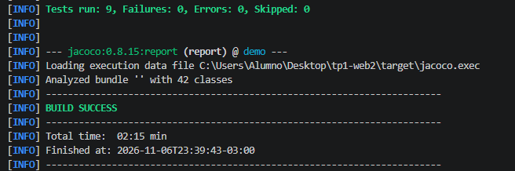
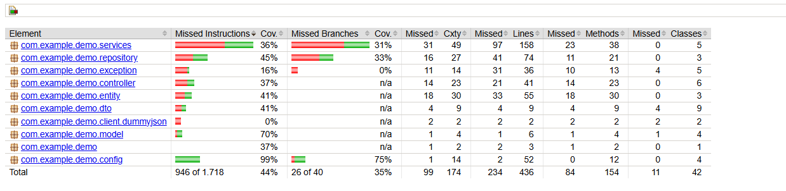
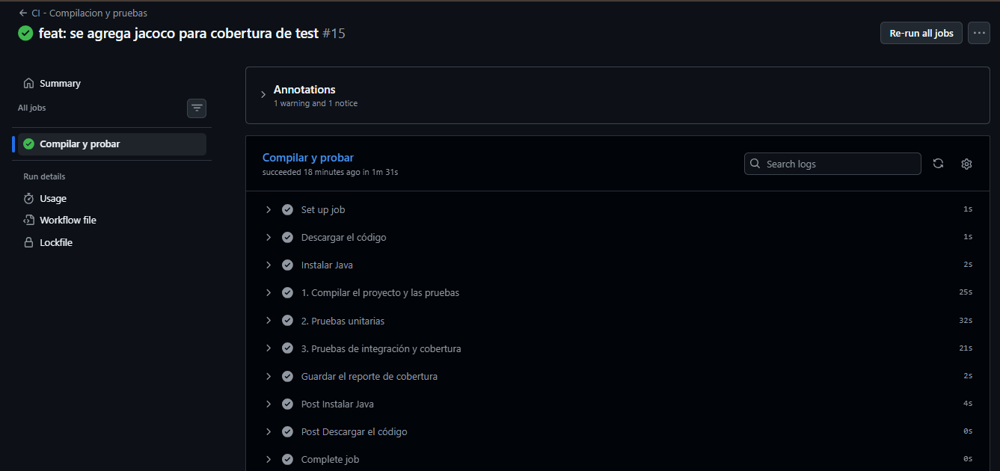
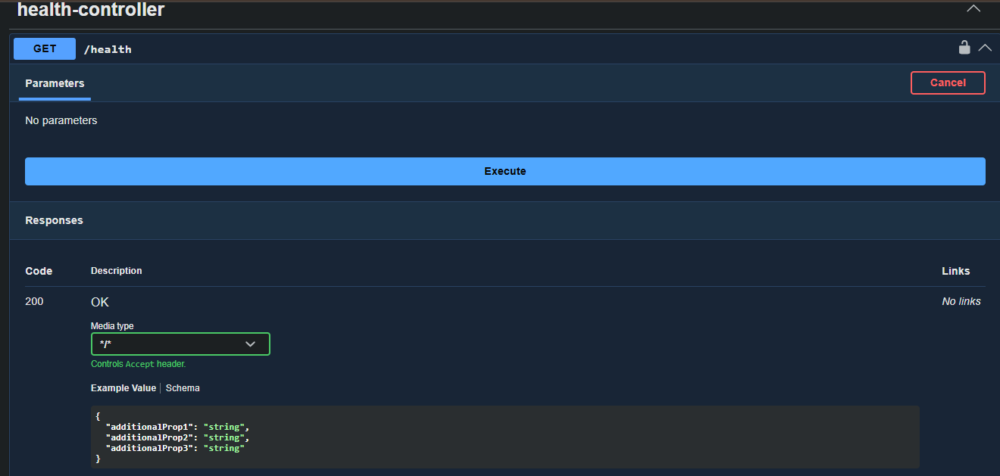
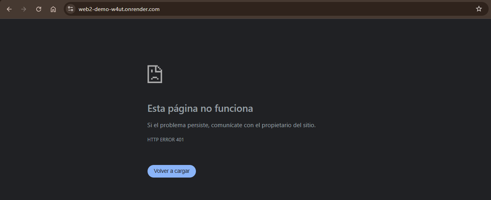
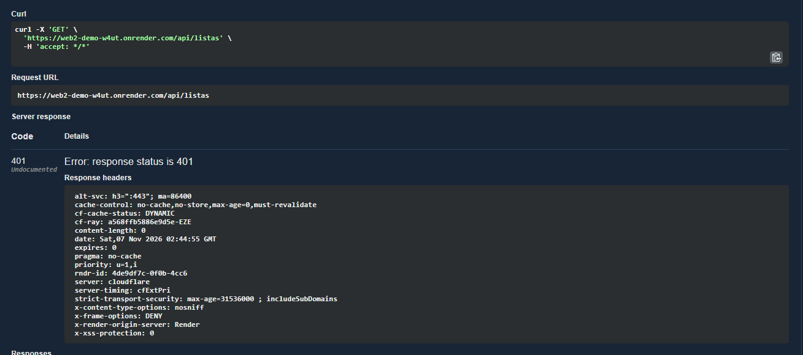
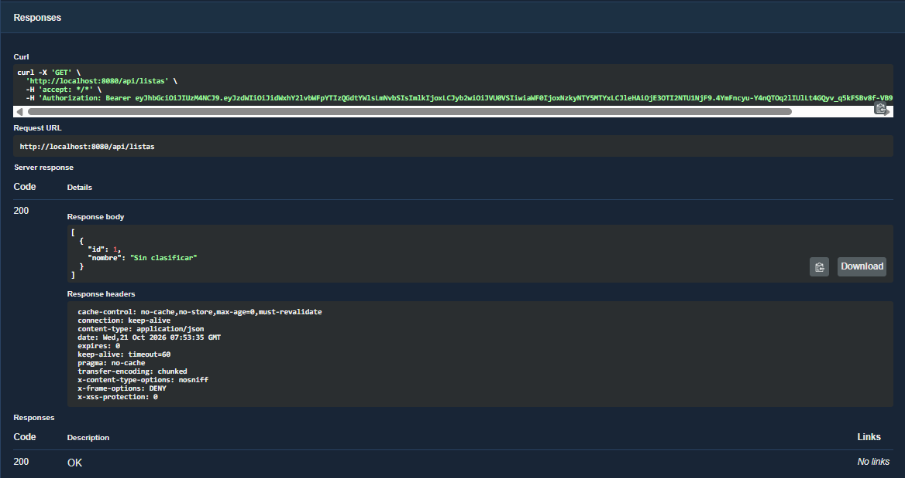
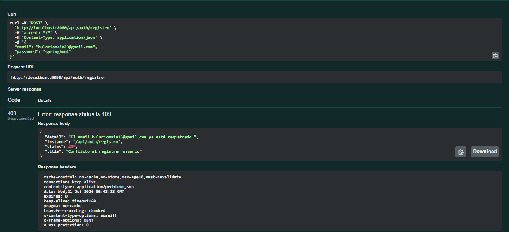

# API de Favoritos - Trabajo Práctico 1

Esta es una API RESTful desarrollada con Spring Boot para la gestión de Favoritos. El proyecto implementa una arquitectura por capas (Controller, Service, Repository), validación de datos de entrada y consume la API externa de DummyJSON para verificar la existencia de los productos antes de guardarlos.

## Instrucciones para levantar el proyecto

1. Clonar este repositorio.
2. Abrir el proyecto en tu IDE (como Visual Studio Code o IntelliJ).
3. Asegurarte de tener instalado Java 17 o superior.
4. Ejecutar la clase principal `DemoApplication.java` (o correr el comando `./mvnw spring-boot:run` en la terminal).
5. El servidor se iniciará en el puerto `8080`.

## Documentación (Swagger UI)

La API está completamente documentada con OpenAPI. Una vez que el proyecto esté corriendo, podés explorar y probar todos los endpoints desde la interfaz gráfica de Swagger ingresando a:

👉 **[http://localhost:8080/swagger-ui/index.html](http://localhost:8080/swagger-ui/index.html)**

## Evidencia de Pruebas

En la carpeta `/evidencia` de este repositorio se encuentran las capturas de pantalla o colecciones que demuestran el correcto funcionamiento de los casos de éxito y de error para los recursos solicitados.

# Puertos y adaptadores: Migraciones de memoria con JPA - Trabajo Práctico 2

## Clases modificadas vs Clases no modificadas

* **Clases que NO cambiaron:**
  * `FavoritoController`: Sigue atendiendo las peticiones HTTP y delegando en la interfaz de servicio sin conocer dónde se guardan los datos.
  * `FavoritoService`: Sigue ejecutando la lógica de negocio y las validaciones dependiendo exclusivamente del contrato `FavoritoRepository`.
  * `Favorito` (modelo de dominio / record): Mantiene su inmutabilidad y representación de negocio independiente de la infraestructura de persistencia.
  * `FavoritoRequestDTO` y `FavoritoResponseDTO`: Mantienen la estructura del contrato de entrada y salida de la API.

* **Clases que cambiaron o se agregaron:**
  * `FavoritoEntity` (nueva): Clase anotada con `@Entity` para que Hibernate gestione el ciclo de vida, la tabla relacional y el estado mutable requerido por JPA.
  * `FavoritoJpaRepository` (nueva): Interfaz de infraestructura que extiende `JpaRepository<FavoritoEntity, Long>` de Spring Data.
  * `FavoritoRepositoryAdapter` (nueva): Implementación concreta que cumple el contrato del puerto `FavoritoRepository`, mapeando entre el record de dominio `Favorito` y `FavoritoEntity`.
  * `MemoryFavRepository` (eliminada): Se removió la implementación en memoria para que Spring inyecte el nuevo adaptador JPA sin ambigüedad.

### Justificacion

Esta migración fue posible gracias al principio de inversión de dependencias y la arquitectura hexagonal:
`FavoritoRepository` actúa como un **puerto** (un contrato abstracto que define que operaciones necesita el dominio). 
Tanto la implementación en memoria (`MemoryFavRepository`) como la de base de datos relacional (`FavoritoRepositoryAdapter`) son **adapters** intercambiables. La lógica de negocio (`FavoritoService`) depende únicamente del puerto, por lo que cambiar el soporte de almacenamiento de un `Map` a PostgreSQL mediante JPA/Hibernate no requiere modificar ninguna línea de código del dominio, el servicio ni los controladores.


## consigna 8:
### Evolución del esquema con Flyway (Migración V4)
No se modifican migraciones anteriores (`V1`, `V2`, `V3`) porque ya fueron aplicadas en la base de datos y registradas con un hash/checksum en `flyway_schema_history`. Modificar un archivo pasado rompe la integridad de versiones de Flyway e invalida despliegues productivos. Los cambios incrementales siempre deben realizarse mediante una migración nueva hacia adelante.

### Transaccionalidad y Atomicidad (ACID)
La operación `mover-favoritos` requiere `@Transactional` para garantizar la **Atomicidad** (la 'A' de ACID). Si fallara la eliminación de la lista origen después de haber reasignado los favoritos, sin `@Transactional` la base quedaría en un estado inconsistente parcial (favoritos mudados pero el origen sin borrar). Con `@Transactional`, si cualquier sentencia falla, se ejecuta un rollback automático devolviendo la base a su estado original.

---

# Seguridad, pruebas e integración continua - Trabajo Práctico 3

## Autorización y Propiedad de Recursos (Consigna 4.5)
La lógica de autorización (verificar si el usuario es dueño de la lista o es `ADMIN`) se implementó en la capa de **Servicio** (`ListaService`).
Se eligió esta capa en lugar del Controlador porque la propiedad de un recurso es una **regla de negocio fundamental**. Si en el futuro se exponen estas operaciones por otra vía (por ejemplo, eventos internos, tareas programadas o una interfaz CLI), la regla de seguridad debe seguir aplicando. El Controlador debe limitarse a recibir la petición HTTP, no a procesar lógica de propiedad.
Para lograrlo limpiamente sin ensuciar los parámetros de los métodos, el servicio lee el ID y el rol del usuario directamente del `SecurityContextHolder` inyectado por el filtro JWT (`JwtAuthenticationFilter`).

## Cómo correr los tests

El proyecto incluye una suite de pruebas unitarias (`ListaServiceTest`, `UsuarioServiceTest`) y pruebas de integración (`SeguridadIT`). Las pruebas de integración utilizan **Testcontainers** para levantar una base de datos PostgreSQL real efímera y **Flyway** para aplicar las migraciones (`V1` a `V6`) automáticamente desde cero antes de ejecutar los tests.

### Requisitos previos
- **Java 25** instalado y configurado.
- **Docker Desktop** iniciado (requerido por Testcontainers para levantar el contenedor de PostgreSQL).

### Comandos
- Para ejecutar todas las pruebas localmente (unitarias + integración) y generar el reporte de cobertura con JaCoCo:
  ```bash
  ./mvnw test
  ```
  *(En Windows PowerShell o CMD: `.\mvnw.cmd test`)*
- Para ejecutar el ciclo completo de verificación:
  ```bash
  ./mvnw clean verify
  ```
- Para visualizar el reporte de porcentaje de cobertura de **JaCoCo** en el navegador:
  ```text
  target/site/jacoco/index.html
  ```

## Integración Continua (CI) y cómo leer el resultado

El flujo de integración continua está configurado en `.github/workflows/ci.yml` mediante **GitHub Actions** y se dispara automáticamente en cada `push` y `pull_request` al repositorio.

# **Link a la corrida exitosa del workflow en GitHub Actions:**  
**[https://github.com/maia2303/tp1-web2/actions/runs/42328947065/job/128270746432](https://github.com/maia2303/tp1-web2/actions/runs/42328947065/job/128270746432)**

### Qué hace el pipeline
1. Descarga el código del repositorio (`actions/checkout`).
2. Configura **Java 25 (Temurin)** y la caché de dependencias de Maven (`actions/setup-java`).
3. Compila el proyecto y las clases de prueba (`./mvnw -B test-compile`).
4. Ejecuta las pruebas unitarias y de integración con Testcontainers + Flyway (`./mvnw -B test` y `./mvnw -B verify`).
5. Sube el reporte de cobertura de JaCoCo (`target/site/jacoco`) como artefacto (`reporte-de-cobertura`).

### Cómo leer el resultado en GitHub
1. Ingresá a la pestaña **Actions** del repositorio en GitHub.
2. En el listado de ejecuciones del workflow **"CI - Compilacion y pruebas"**, observá el ícono de estado de cada commit:
   - **Check verde (✓)**: el proyecto compiló, Flyway aplicó todas las migraciones contra la base limpia en Docker y todos los tests pasaron.
   - **Cruz roja (✗)**: algún paso falló (error de compilación, migración inválida o algún test roto).
3. Haciendo clic sobre la corrida y luego sobre el job **"Compilar y probar"**, podés desplegar cada paso (`1. Compilar...`, `2. Pruebas unitarias`, `3. Pruebas de integración y cobertura`) para inspeccionar los logs detallados de Maven y JUnit, y al final de la página descargar el artefacto `reporte-de-cobertura`.

## Pasos de despliegue

La aplicación se empaqueta mediante un `Dockerfile` multi-etapa (compilación con `eclipse-temurin:25-jdk` y ejecución ligera con `eclipse-temurin:25-jre`) y se despliega automáticamente en **Render** mediante el Blueprint definido en `render.yaml`, conectado a una base de datos PostgreSQL remota.

# **URL pública del despliegue:**  
**[https://web2-demo-w4ut.onrender.com](https://web2-demo-w4ut.onrender.com)**  
# **Swagger UI en producción:**  
**[https://web2-demo-w4ut.onrender.com/swagger-ui/index.html](https://web2-demo-w4ut.onrender.com/swagger-ui/index.html)**  
# **Endpoint de estado (`/health`):**  
**[https://web2-demo-w4ut.onrender.com/health](https://web2-demo-w4ut.onrender.com/health)**

### Pasos seguidos
1. **Preparación de variables de entorno**:
   En `application.properties` se parametrizaron los datos sensibles con `${VARIABLE:valorPorDefecto}` para mantener el funcionamiento local sin configuración extra:
   - `DB_URL`: URL JDBC de conexión a PostgreSQL (`jdbc:postgresql://HOSTNAME:5432/DATABASE?sslmode=require`).
   - `DB_USERNAME`: usuario de la base de datos remota (`web2-db`).
   - `DB_PASSWORD`: contraseña de la base de datos remota (`web2-db`).
   - `JWT_SECRET`: clave secreta generada para firmar y validar los tokens JWT.
   - `PORT`: puerto asignado por Render (por defecto `8080` en local).
2. **Creación del Blueprint en Render (`render.yaml`)**:
   - Se vinculó el repositorio de GitHub a Render (rama `main`) mediante **New → Blueprint**.
   - Render aprovisionó automáticamente la base de datos PostgreSQL (`web2-db`) y el Web Service Docker (`web2-demo`) con `healthCheckPath: /health` y `autoDeployTrigger: checksPass` (despliega solo cuando el CI de GitHub pasa en verde).
3. **Configuración de `DB_URL` y puesta en línea**:
   - Una vez creada la base `web2-db`, se tomó su hostname interno y nombre de base para completar la variable de entorno `DB_URL` en formato JDBC dentro de **Environment** del servicio `web2-demo`, disparando el despliegue.
4. **Verificación del despliegue**:
   - En la pestaña **Logs** de Render se verificó que **Flyway** aplicó las migraciones `V1` a `V6` sobre la base remota y que el servicio inició sin errores (`Your service is live`).
   - Se verificó `GET /health` respondiendo `200 OK`.
   - Se verificó que `GET /api/listas` responde `401 Unauthorized` sin token y `200 OK` al autenticarse con un token JWT válido.

## Evidencias del Trabajo Práctico 3

Las capturas de evidencia se encuentran en `src/main/java/com/example/demo/evidencia/`:

1. **Suite de tests en verde en la terminal local (`./mvnw test`)**:
   

2. **Reporte de cobertura con JaCoCo (`target/site/jacoco/index.html`)**:
   

3. **Pipeline de Integración Continua (GitHub Actions) en verde**:
   

4. **Endpoint de estado `GET /health` respondiendo `200 OK`**:
   

5. **Protección del sitio en producción (`401 Unauthorized` sin token)**:
   

6. **Endpoint protegido `GET /api/listas` sin token respondiendo `401 Unauthorized`**:
   

7. **Endpoint protegido `GET /api/listas` con token JWT válido respondiendo `200 OK`**:
   

8. **Registro con email duplicado `POST /api/auth/registro` respondiendo `409 Conflict`**:
   
